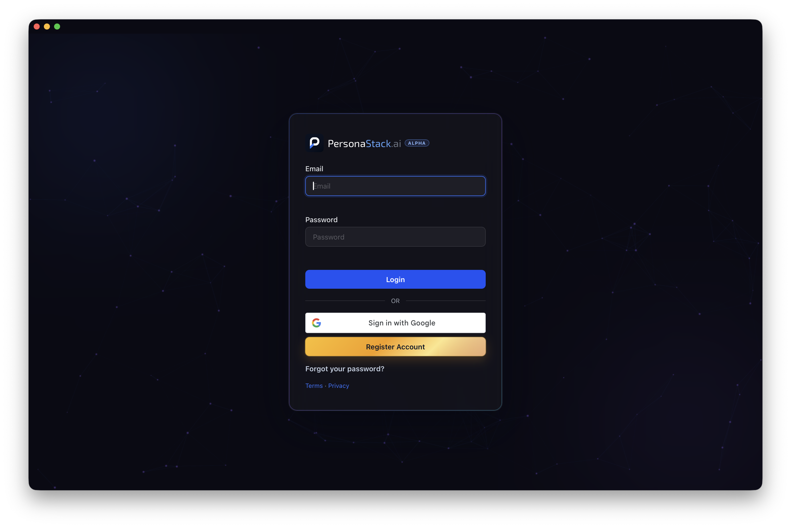

<div align="center">
  
  <h1>PersonaStack for macOS</h1>
  <p>Your PersonaStack workspaces in a native Mac app.</p>
  
</div>

## Install with Homebrew

Requires macOS 14 or later. Copy and paste this command into Terminal:

```sh
brew install --cask personastack/tap/personastack
```

Open **PersonaStack** from Applications and sign in.

The current app is unsigned. If macOS blocks the first launch, choose **Open Anyway** in **System Settings → Privacy & Security**.

[Download the latest disk image](https://github.com/personastack/homebrew-tap/releases/latest) · [Visit PersonaStack](https://personastack.ai)
